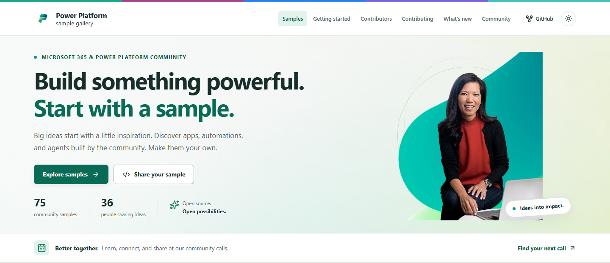
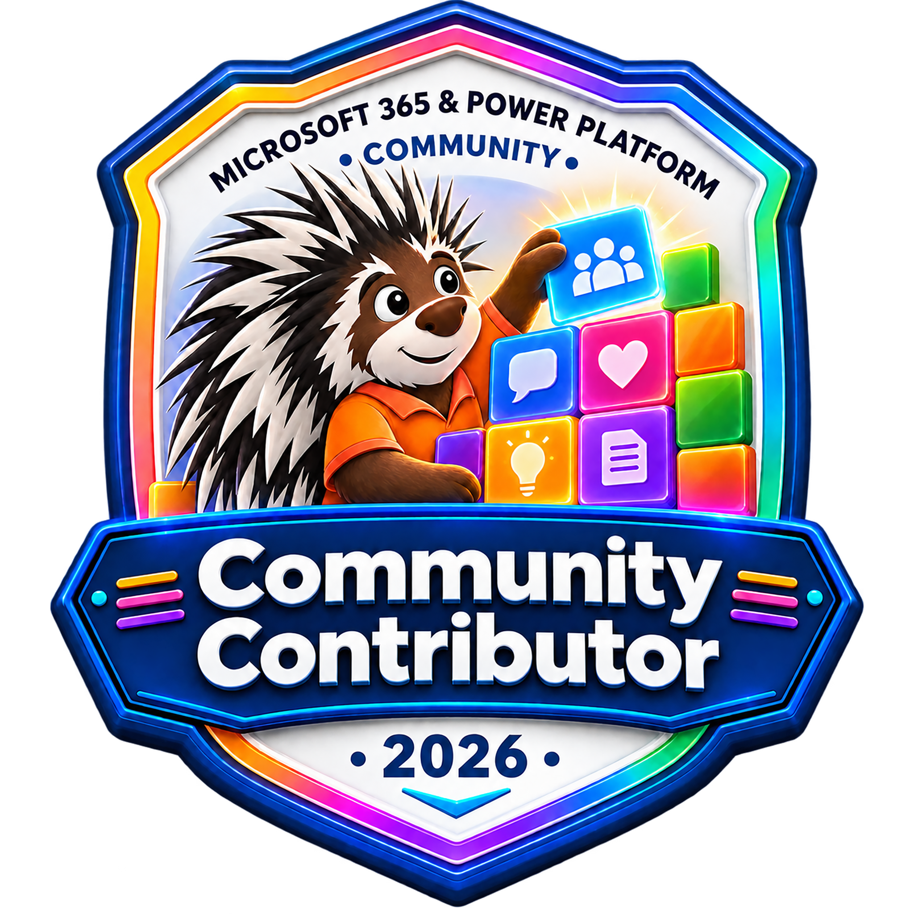

# Power Platform Samples

[](https://pnp.github.io/powerplatform-samples/)

**[Explore the Power Platform sample gallery](https://pnp.github.io/powerplatform-samples/)**

This repository contains community samples that demonstrate different usage patterns for the Microsoft Power Platform.

## Power Platform sample gallery

Discover community-built apps, automations, agents, and solutions. Browse by product, search for a scenario, meet the contributors, and follow each sample's setup guide. The gallery includes contribution guidance, community calls, and the community contributor badge.

The gallery is a static Astro application in [site](./site/). With Node.js 22.12 or later installed, start it locally:

```shell
cd site
npm ci
npm run dev
```

Open the local address printed by Astro, normally <http://127.0.0.1:4321/powerplatform-samples/>.

For production builds and validation:

```shell
npm run validate:readme-trackers
npm test
npm run check
npm run build
npm run preview
```

See the [site development guide](./site/README.md) for browser testing, artwork, metadata, and tracking details. Pull requests automatically run the gallery checks. GitHub Pages publication runs after relevant changes reach `main` and refreshes legacy metadata daily.

The [legacy collections](https://pnp.github.io/powerplatform-samples/legacy-samples/) and compatible [`samples.json` export](https://pnp.github.io/powerplatform-samples/samples.json) keep older examples discoverable while migration is assessed.

## Sample migration

New sample contributions belong in this repository. Older per-product collections are retained while migration and their contribution backlogs are reviewed; archiving a repository makes it read-only rather than deleting its source or existing links.

- [Power Fx Samples](https://github.com/pnp/powerfx-samples)
- [Power Apps Samples](https://github.com/pnp/powerapps-samples)
- [Power Automate Samples](https://github.com/pnp/powerautomate-samples)
- [Power Virtual Agents Samples (already archived)](https://github.com/pnp/powerva-samples)

> You're welcome to bring samples from the other repositories! The more people help, the faster we'll move all the samples here.

See the [legacy repository activity and archive-readiness assessment](./legacy-repositories-assessment.md) for recent contributions, open PRs/issues, migration gaps, and recommended prerequisites. No additional repositories are being archived as part of publishing this gallery.
## Have issues or questions?

Please use following logic on submitting your questions or issues to right location to ensure that they are noticed and addressed as soon as possible.

## Additional resources

- [Power Platform Community](https://powerusers.microsoft.com/)

## Join the community calls

Stay up to date with the latest Copilot, Microsoft 365, and Power Platform topics by joining our weekly community calls. Everyone is welcome. Come to learn, ask questions, and connect with the community.

[View the call schedule and download the recurring invites](https://aka.ms/community/calls) so you don't miss an upcoming call.

## Using the samples

For more info about how to use the Power Platform Samples, please look for the Prerequisites & the Minimal Path to Awesome sections in the readme.md file in every sample directory.

## Authors

This repository's contributors are all community members who volunteered their time to share code samples. Work is done as an open source community project, which each sample contained in their own solution.

## Contributions

These samples are direct from the feature teams, [PnP team](http://aka.ms/m365pnp) or shared by the community. We welcome your input on issues and suggestions for new samples. We do also welcome community contributions. If you have any questions, just let us know.

Please have a look on our [Contribution Guidance](./CONTRIBUTING.md) before you submit your pull requests, so that we can get your contribution processed as fast as possible.

### Community contributor badge

The Microsoft 365 & Power Platform Community contributor badge celebrates people who share their knowledge. Learn about [community recognition](https://aka.ms/community/recognition), contribute a sample, or [sign up to present a community demo](https://aka.ms/community/request/demo).



## Code of Conduct

This repository has adopted the [Microsoft Open Source Code of Conduct](https://opensource.microsoft.com/codeofconduct/). For more information see the [Code of Conduct FAQ](https://opensource.microsoft.com/codeofconduct/faq/) or contact [opencode@microsoft.com](mailto:opencode@microsoft.com) with any additional questions or comments.

> Sharing is caring ❤!
