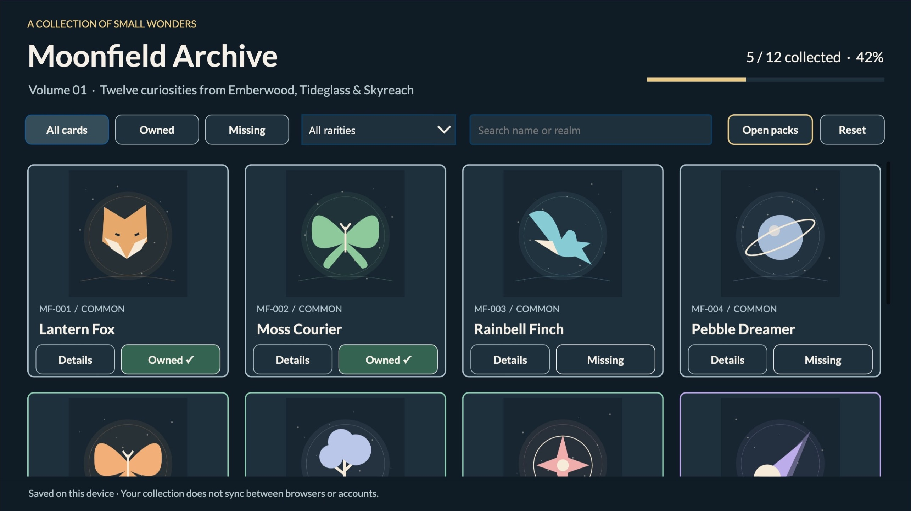
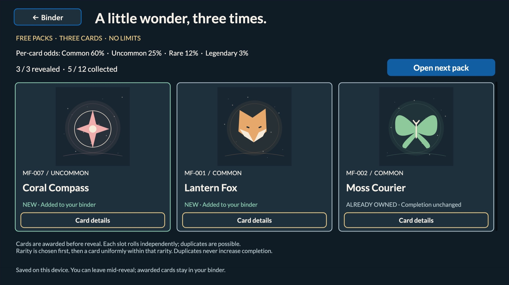

# Moonfield Archive

## Summary

A collectible-card binder built as a real Power Apps canvas app. Open free three-card packs, collect twelve original fictional wonders across three realms, and track your progress. No external data source or connector is required.




## Applies to


## Compatibility

No premium connectors, external APIs, flows, or runtime Dataverse tables. A suitable Power Apps entitlement and an environment where you can create canvas apps are still required. The app uses classic canvas controls; its exported YAML authoring format is Preview. Prefer editing the `.msapp` in Studio. Desktop/tablet layout, 1366 × 768 with scale-to-fit; phone layout is not optimized.

## Contributors

* [Gavin Warner](https://github.com/GavinWarner05)

## Version history

| Version | Date | Comments |
| --- | --- | --- |
| 1.0.0.3 | 2026-10-12 | Free unlimited packs, weighted rarity, automatic awards and duplicate-safe completion |
| 1.0.0.2 | 2026-10-12 | Accessibility cleanup and unmanaged solution export |
| 1.0.0 | 2026-10-12 | Initial private sample, original SVG artwork, device-local collection |

## Prerequisites

- Power Apps access and maker permission in a development environment.
- A current desktop browser. Browser storage must be available for persistence.
- Optional: Python 3 for the dependency-free reference tests and artwork generator; Microsoft Power Platform CLI for source inspection.

## Minimal path to awesome

1. Open the Power Apps maker portal and select your development environment.
2. Choose **Apps → Import app → From file (.msapp)** and select `solution/MoonfieldArchive.msapp`. Depending on portal version, use Studio **Open → Browse** instead.
3. Save the imported app under a new name. Run App OnStart or restart Preview to initialize the catalogue.
4. Preview it, then save and publish your own private development version. Publishing an app version does not itself share it.
5. Open the app in the Power Apps player. Select **Open packs → Open free pack**, then tap each card to reveal it. New cards are automatically awarded and saved before reveal. Return to the binder, switch **Owned/Missing**, combine rarity with search, or select **Details** for a card's story.
6. **Reset** requires confirmation. **Keep collection** cancels it.

No connection credentials or sample data import are needed. Alternatively, import `solution/MoonfieldArchive_1_0_0_3.zip` through **Solutions → Import solution** in a Dataverse-enabled development environment with appropriate maker/customizer permissions. This unmanaged ZIP contains only the sample canvas app and its neutral publisher. Review any existing component matches before importing; use a separate development environment for a clean import. The export, local unpack/repack, and a clean-target solution import passed. The imported private player was tested in Microsoft Edge on macOS on 2026-10-18. See [validation](docs/validation.md).

## Features

- Twelve original SVG illustrations, names and short stories, embedded in the app.
- Four named rarities with distinct borders, searchable names and realms.
- Combined ownership, rarity and search filters; explicit empty states.
- Free unlimited three-card packs; no purchases, currency, daily limits or trading.
- Tap-to-reveal cards marked New or Already owned; duplicate quantities are not tracked.
- Completion count, rounded percentage and progress meter; only unique cards count.
- Gentle fade when opening card details; explicit buttons and accessible image descriptions.
- Device-local ownership with a visible session-only fallback when storage fails.

Ownership is stored in the current device/browser only. It is not backed up or synchronized across browsers or accounts. Clearing browser storage can erase it. Never adapt this store for sensitive data without revisiting the design.

## Pack odds and saving

Each of three slots independently selects a rarity, then a card uniformly within that rarity. Draws are with replacement, so a pack can contain duplicates.

| Rarity | Per-slot chance | Cards in pool | Chance of each card per slot |
| --- | ---: | ---: | ---: |
| Common | 60% | 4 | 15% |
| Uncommon | 25% | 3 | 8⅓% |
| Rare | 12% | 3 | 4% |
| Legendary | 3% | 2 | 1.5% |

Odds are displayed before opening. New/Already owned is determined at pack creation in slot order: only the first occurrence of a previously missing card is New. Reveal all three to enable the next pack. Revealing never awards a second copy.

Leaving the screen preserves the current reveal session. Reloading closes the transient pack, but successfully saved awards remain in the binder, even when left unrevealed. If saving fails, the app clearly shows **NOT SAVED · Session only** and **Retry saving**. Keep the app open and retry; closing can lose unsaved cards. Existing `MoonfieldOwnedV1` collections retain their IDs and are compatible with this update in the same app/browser. Importing as a different app can use a separate storage scope.

## Source and verification

`sourcecode/solution` contains the extracted unmanaged solution. `sourcecode/studio` contains the final Studio-normalized `.pa.yaml` source and `.msapr`. `sourcecode/cards.json` and `sourcecode/generate.py` contain the original catalogue and artwork generator. Edits to JSON do not automatically update the embedded app catalogue.

To rebuild the solution archive from the extracted solution, run this from the sample directory with Power Platform CLI:

```bash
pac solution pack --zipfile MoonfieldArchive-repacked.zip --folder sourcecode/solution --packagetype Unmanaged
```

This packages the embedded `.msapp` in `sourcecode/solution/CanvasApps`; it does not rebuild that app from the separate review YAML. Edit the app in Studio and export it again when changing formulas. PAC-generated internal folder names and casing are preserved.

Run `python3 -m unittest discover -s tests -v` from this sample directory. These are local reference/data checks, not Power Fx execution. See [architecture](docs/architecture.md) and [exact validation results](docs/validation.md).

## Help

We do not support samples, but this community is always willing to help. For issues, questions or suggestions, [open an issue in the Power Platform samples repository](https://github.com/pnp/powerplatform-samples/issues/new/choose).

## Disclaimer

**THIS CODE IS PROVIDED *AS IS* WITHOUT WARRANTY OF ANY KIND, EITHER EXPRESS OR IMPLIED, INCLUDING ANY IMPLIED WARRANTIES OF FITNESS FOR A PARTICULAR PURPOSE, MERCHANTABILITY, OR NON-INFRINGEMENT.** All characters, artwork and lore in this sample were created for this sample; no third-party card franchise assets are included. Review licensing and tenant requirements before production use.


