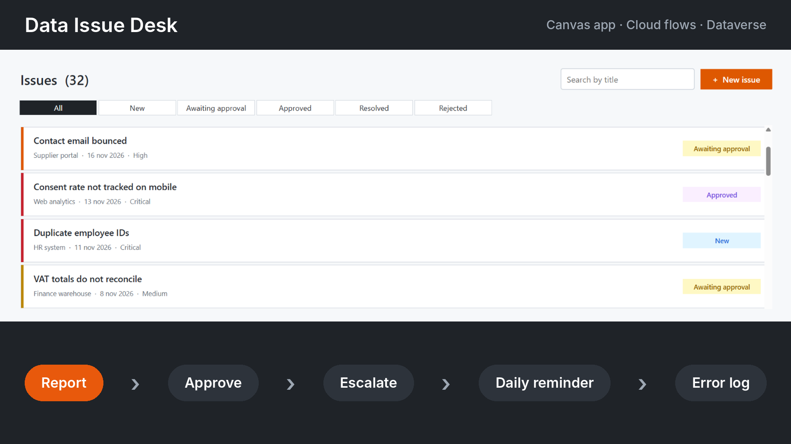
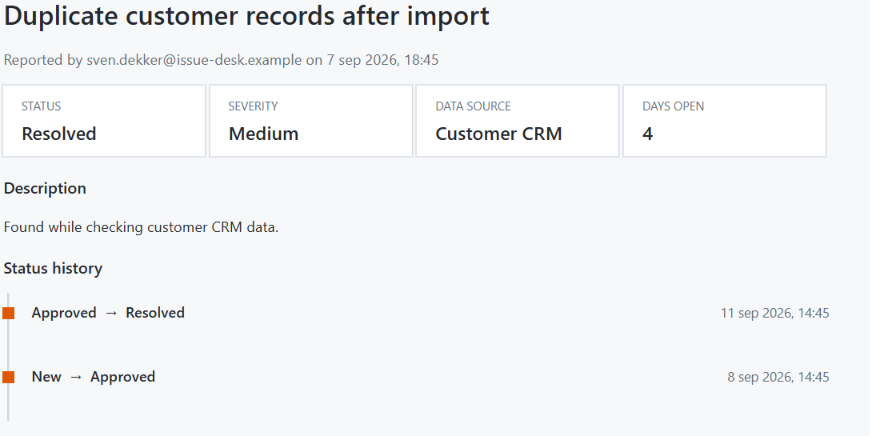
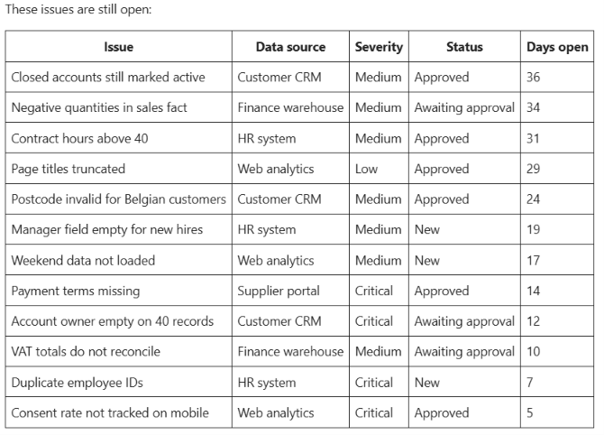

# Data Issue Desk

## Summary

Business users report data quality issues from a responsive canvas app. High and critical issues go through an approval, anyone can escalate an issue from the app, and the data team receives a daily email with the issues that are overdue. Every status change is written to an issue log, and every cloud flow logs its own failures to a Flow error table in Dataverse.







## Gallery preview and metadata

The gallery metadata for this sample is in `assets/sample.json`.

## Applies to


## Compatibility


## Contributors

* [Jordy Roijen](https://github.com/JordyRdev)

## Version history

Version|Date|Comments
-------|----|--------
1.0|November 25, 2026|Initial release

## Prerequisites

* An environment with Dataverse and a Power Apps license that includes Dataverse (premium).
* Connections for **Microsoft Dataverse**, **Approvals** and **Outlook.com**. The Outlook.com connection is used by one child flow only; see [Features](#features) to switch it to Office 365 Outlook.

## Minimal path to awesome

### Using the solution zip

* [Download](./solution/data-issue-desk.zip) the `.zip` from the `solution` folder
* Within **Power Apps**, import the solution `.zip` file using **Solutions** > **Import solution** and select the `.zip` file.
* During import, select a connection for each connection reference:
  * **Data Issue Desk - Dataverse**: Microsoft Dataverse
  * **Data Issue Desk - Approvals**: Approvals
  * **Data Issue Desk - Outlook.com**: Outlook.com
* Set the environment variables:
  * **Approver email**: the person who approves high and critical issues
  * **Data team mailbox**: where escalations and the daily reminder are sent
  * **Overdue after (days)**: open issues older than this appear in the daily reminder (default `5`)
* Turn on the cloud flows in this order: **Notify | Send email**, **Issue | Request approval**, **Issue | Escalate**, **Issue | Overdue reminder**.
* Add a few rows to the **Data source** table, then open the **Report a Data Issue** app and report an issue.

### Using the source code

You can also use the [Power Platform CLI](https://aka.ms/pac/docs) to pack the source code by following these steps:

* Clone the repository to a local drive
* Pack the source files back into a solution `.zip` file:

  ```bash
  pac solution pack --zipfile pathtodestinationfile --folder pathtosourcefolder --processCanvasApps
  ```

  Making sure to replace `pathtosourcefolder` to point to the path to this sample's `sourcecode` folder, and `pathtodestinationfile` to point to the path of this solution's `.zip` file (located under the `solution` folder)
* Within **Power Apps**, import the solution `.zip` file using **Solutions** > **Import solution** and select the `.zip` file you just packed.

## Features

This solution illustrates the following concepts on top of the Power Platform:

* **Dataverse data model**: four tables (Data source, Issue, Issue log, Flow error), global choices for severity and status, lookups with restrict and cascade-delete behavior, and an alternate key on the data source name.
* **Responsive canvas app**: auto-layout containers instead of a fixed screen size, named formulas in `App.Formulas` for the theme and the current user, delegable `Filter` and `SortByColumns` on Dataverse, validation before `Patch`, and `IfError` with `Notify` for user-friendly errors.
* **Calling a flow from the app**: the Escalate button runs a flow with the Power Apps (V2) trigger and refreshes the status timeline afterwards.
* **Approval flow**: a Dataverse trigger with a filter on severity starts an approval with the issue details in markdown and writes the outcome and the approver's comment to the issue log.
* **Scheduled flow**: every morning, open issues older than the configured number of days are sent as an HTML table built with the Select and Create HTML table actions.
* **Child flow**: all email goes through one child flow, so the email connector can be replaced in one place. To use Office 365 Outlook, change the **Send email** action in **Notify | Send email**; the other flows do not change.
* **Error handling**: every flow has a Try scope and a Catch scope that runs on failure or timeout, writes the flow name, a link to the run and the error to the Flow error table, and ends the run as failed.
* **ALM-ready**: all configuration is in environment variables and all connections go through connection references, so the solution can be deployed to other environments without editing the flows.

## Help

For product and how-to questions, visit the [Power Platform Community forums](https://community.powerplatform.com/), our primary discussion space. For a reproducible sample bug or repository suggestion, [open an issue in the Power Platform samples repository](https://github.com/pnp/powerplatform-samples/issues/new/choose).

Join the [community calls](https://aka.ms/community/calls), [present your sample](https://aka.ms/community/request/demo), and watch recordings and demos on [Microsoft Community Learning](https://www.youtube.com/@MicrosoftCommunityLearning). Find Power Platform product videos on [Microsoft Power Platform](https://www.youtube.com/@mspowerplatform).

## Disclaimer

**THIS CODE IS PROVIDED *AS IS* WITHOUT WARRANTY OF ANY KIND, EITHER EXPRESS OR IMPLIED, INCLUDING ANY IMPLIED WARRANTIES OF FITNESS FOR A PARTICULAR PURPOSE, MERCHANTABILITY, OR NON-INFRINGEMENT.**


