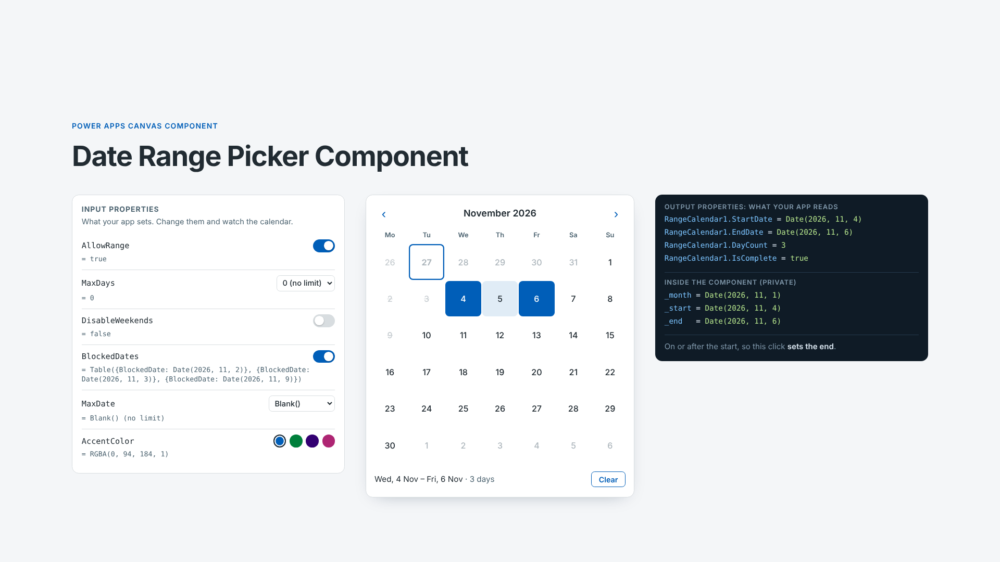

# Date Range Picker Component

## Summary

A reusable canvas component for picking a single date or a date range, built for booking apps. It marks today and disables past days. It also applies booking rules set through input properties: earliest and latest dates, blocked dates, no weekends, and a maximum range length. Your app reads the result from output properties (`StartDate`, `EndDate`, `DayCount`, `IsComplete`).

It's an input control. It complements the existing [Calendar Component](../calendar-component/), which displays events.



## Applies to


## Compatibility


## Contributors

* [Asdren Begaj](https://github.com/asdrenbegaj)

## Version history

Version|Date|Comments
-------|----|--------
1.0|October 27, 2026|Initial release

## Prerequisites

None. The component uses no data sources, connectors or premium features. Importing the solution needs an environment with Dataverse and permission to import solutions (Environment Maker role).

## Minimal path to awesome

### Using the solution zip

* [Download](./solution/date-range-picker-component.zip) the `.zip` from the `solution` folder.
* In [Power Apps](https://make.powerapps.com), go to **Solutions** > **Import solution** and select the `.zip` file. This adds the **Range Calendar** component library to your environment.
* Open your canvas app in Power Apps Studio. Select **Insert** > **Get more components**, tick **cmpRangeCalendar**, then select **Import**.
* Insert **cmpRangeCalendar** from **Library components**. Read the selection from its output properties, e.g. `RangeCalendar1.StartDate`.

### Using the source code

You can also use the [Power Platform CLI](https://learn.microsoft.com/power-platform/developer/cli/introduction) to pack the source code:

* Clone the repository to a local drive.
* Pack the source files back into a solution `.zip` file:

  ```bash
  pac solution pack --zipfile pathtodestinationfile --folder pathtosourcefolder --processCanvasApps
  ```

  Replace `pathtosourcefolder` with the path to this sample's `sourcecode` folder, and `pathtodestinationfile` with the path for the new `.zip` file.
* Import the `.zip` file using **Solutions** > **Import solution**.

## Using the component

### Input properties

All are optional and have defaults.

Property|Type|Default|Description
--------|----|-------|-----------
`MinDate`|Date and time|`Today()`|Days before this are disabled. `Blank()` allows past dates.
`MaxDate`|Date and time|`Blank()`|Days after this are disabled. Blank means no limit.
`BlockedDates`|Table|`Table({BlockedDate: Date(1900, 1, 1)})`|Days that can't be picked, in a column called `BlockedDate`. A range can't cross a blocked day.
`DisableWeekends`|Boolean|`false`|Saturdays and Sundays can't be a start or end day. A range can still span a weekend.
`AllowRange`|Boolean|`true`|Set to `false` for single-day picking.
`MaxDays`|Number|`0`|Longest range allowed, counting both ends. `0` means no limit.
`AccentColor`|Color|`RGBA(0, 94, 184, 1)`|Colour of the selection, today marker and buttons. Lighter shades are derived from it.

### Output properties

Property|Type|Description
--------|----|-----------
`StartDate`|Date and time|First selected day, or blank.
`EndDate`|Date and time|Last selected day. Equals `StartDate` until an end day is picked.
`DayCount`|Number|Number of days selected, counting both ends. `0` when nothing is selected.
`IsComplete`|Boolean|`true` once an end day has been picked.

`Reset(RangeCalendar1)` clears the selection and returns to the current month.

### Example: saving a booking

```powerfx
// btnBook.DisplayMode
If(RangeCalendar1.IsComplete, DisplayMode.Edit, DisplayMode.Disabled)

// btnBook.OnSelect
Patch(Bookings, Defaults(Bookings),
    { StartDate: RangeCalendar1.StartDate, EndDate: RangeCalendar1.EndDate });
Reset(RangeCalendar1)
```

### Example: blocking days that are already booked

Bookings are usually stored as start and end dates. Expand them into single days and pass the result to `BlockedDates`:

```powerfx
Clear(colBlocked);
ForAll(
    Filter(Bookings, AssetID = varAsset.ID, EndDate >= Today()) As b,
    Collect(colBlocked,
        ForAll(Sequence(DateDiff(b.StartDate, b.EndDate, TimeUnit.Days) + 1, 0) As i,
            { BlockedDate: DateAdd(b.StartDate, i.Value, TimeUnit.Days) }))
)
// RangeCalendar1.BlockedDates = colBlocked
```

Use dates without a time part, e.g. SharePoint *Date only* columns, `Today()` or `Date()`. Otherwise blocked dates won't match.

## Features

This sample illustrates the following concepts:

* Building a month grid from `Sequence(42, 0)`: six weeks, offset with `Weekday(first, StartOfWeek.Monday) - 1` so every row starts on Monday, and a fixed height for every month
* Keeping state inside a component. `Set()` variables are scoped to each component instance, so several calendars on one screen keep separate selections and never clash with app variables.
* Combining every booking rule into one `IsDisabled` flag per cell, and using `DisplayMode` so disabled days can't be selected or reached by keyboard
* Selection logic in a single `If()`: if a click can't finish a valid range, it starts a new one. This covers clicking before the start, going over `MaxDays`, and crossing a blocked day.
* Exposing results through output properties and using the built-in `OnReset`, with no reliance on experimental custom event properties
* Theming from a single `AccentColor` input, with lighter shades derived using `ColorFade()`

A [live demo and formula walkthrough](https://asdrenbegaj.github.io/powerapps-range-calendar/) runs the same logic in the browser, and the [project repository](https://github.com/asdrenbegaj/powerapps-range-calendar) has the YAML source and a demo app.

## Help

For product and how-to questions, visit the [Power Platform Community forums](https://community.powerplatform.com/), our primary discussion space. For a reproducible sample bug or repository suggestion, [open an issue in the Power Platform samples repository](https://github.com/pnp/powerplatform-samples/issues/new/choose).

Join the [community calls](https://aka.ms/community/calls), [present your sample](https://aka.ms/community/request/demo), and watch recordings and demos on [Microsoft Community Learning](https://www.youtube.com/@MicrosoftCommunityLearning). Find Power Platform product videos on [Microsoft Power Platform](https://www.youtube.com/@mspowerplatform).

## Disclaimer

**THIS CODE IS PROVIDED *AS IS* WITHOUT WARRANTY OF ANY KIND, EITHER EXPRESS OR IMPLIED, INCLUDING ANY IMPLIED WARRANTIES OF FITNESS FOR A PARTICULAR PURPOSE, MERCHANTABILITY, OR NON-INFRINGEMENT.**


